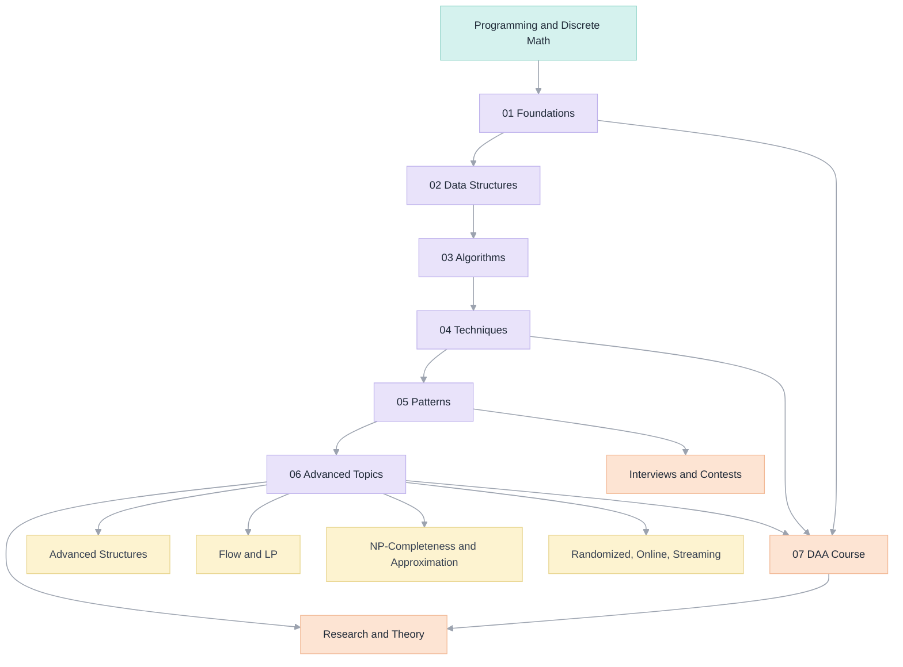

# 🧮 DSA & DAA

**Data Structures, Algorithm Design and Analysis: From Asymptotic Foundations to Approximation, Randomization, and Provable Correctness.**

> A rigorous, implementation-driven learning path and knowledge base for data structures, algorithm design, correctness proofs, complexity analysis, and advanced algorithmic theory.

## 1. Overview

This domain takes you from first principles (asymptotic analysis, arrays, recursion) to research-grade material (amortized analysis, approximation algorithms, NP-completeness, streaming algorithms, and cache-aware design).

It is built around four skills that reinforce each other:

| Skill         | What it means in practice                                                                             |
| ------------- | ----------------------------------------------------------------------------------------------------- |
| **Represent** | Choose and implement the data structure that makes the required operations cheap                      |
| **Design**    | Select and apply a technique (divide and conquer, greedy, DP, reductions, randomization)              |
| **Prove**     | Show that an algorithm is correct and bound its resources rigorously                                  |
| **Verify**    | Test against brute-force oracles, property tests, and benchmarks, so claims are measured, not assumed |

> **Where things live:** this README covers _what to learn and why_. The full directory layout is in [STRUCTURE.md](./STRUCTURE.md).

## 2. Navigation

| Stage | Folder                                                                 | Purpose                                                                | Level      |
| ----: | ---------------------------------------------------------------------- | ---------------------------------------------------------------------- | ---------- |
|     1 | [`01-Foundations/`](./01-Foundations/)                                 | Asymptotics, recurrences, amortized analysis                           | Essential  |
|     2 | [`02-Data-Structures/`](./02-Data-Structures/)                         | Linear, hierarchical, hash-based, graph representations                | Essential  |
|     3 | [`03-Algorithms/`](./03-Algorithms/)                                   | Sorting, searching, graph, string, mathematical algorithms             | Essential  |
|     4 | [`04-Algorithmic-Techniques/`](./04-Algorithmic-Techniques/)           | Divide and conquer, greedy, DP, backtracking, branch and bound         | Essential  |
|     5 | [`05-Problem-Patterns/`](./05-Problem-Patterns/)                       | Recognition and reuse of recurring solution shapes                     | Essential  |
|     6 | [`06-Advanced-Algorithmic-Topics/`](./06-Advanced-Algorithmic-Topics/) | Flow, geometry, FFT, LP, approximation, streaming, advanced structures | Advanced   |
|     7 | [`07-DAA-Course/`](./07-DAA-Course/)                                   | Formal course material: proofs, assignments, exams                     | Academic   |
|     8 | [`08-Cheatsheets/`](./08-Cheatsheets/)                                 | Fast-lookup references                                                 | Continuous |
|     – | [`benchmarks/`](./benchmarks/)                                         | Empirical performance experiments                                      | Optional   |
|     – | [`templates/`](./templates/)                                           | Documentation, proof, and implementation templates                     | Tooling    |
|     – | [`resources/`](./resources/)                                           | Per-book notes and exercises for the 35-book library                   | Notes      |

## 3. Learning Objectives

Objectives are tiered. Reaching a tier means demonstrating the abilities of every tier below it.

**Tier 1: Foundation**

1. Analyze running time and space using asymptotic notation.
2. Implement arrays, linked lists, stacks, queues, hash tables, and binary trees from scratch.
3. Implement standard sorting and searching algorithms and explain their trade-offs.

**Tier 2: Core**

1. Apply BFS, DFS, shortest paths, spanning trees, and topological ordering.
2. Design solutions using divide and conquer, greedy methods, dynamic programming, and backtracking.
3. Recognize recurring problem patterns and choose a suitable data structure from operational requirements.
4. Solve recurrences with the recursion-tree method, the substitution method, and the master theorem.

**Tier 3: Advanced**

1. Prove correctness using loop invariants, induction, and exchange arguments.
2. Analyze amortized cost with aggregate, accounting, and potential methods.
3. Implement balanced trees, Fenwick trees, sparse tables, union-find with path compression, and suffix structures.
4. Apply network flow, matching, and LP duality to reduce problems to well-studied forms.
5. Optimize dynamic programming (convex hull trick, divide-and-conquer optimization, Knuth optimization, SOS DP).

**Tier 4: Expert**

1. Prove NP-hardness via polynomial-time reductions.
2. Design and analyze approximation algorithms with provable guarantees.
3. Analyze randomized algorithms, including expected running time and error probability.
4. Reason about algorithms under constraints: streaming, online, external memory, and parallel models.
5. Explain _why_ an approach works, not just that it works, and communicate trade-offs precisely.

## 4. Prerequisites

| Prerequisite             | Required knowledge                                 | Where to get it                                                  |
| ------------------------ | -------------------------------------------------- | ---------------------------------------------------------------- |
| Programming fundamentals | Functions, loops, recursion, basic OOP             | [`01-Programming-Fundamentals`](../01-Programming-Fundamentals/) |
| Discrete mathematics     | Logic, sets, relations, induction, counting        | [`00-Foundations-and-Math`](../00-Foundations-and-Math/)         |
| Algebra                  | Logarithms, exponents, summations, series          | [`00-Foundations-and-Math`](../00-Foundations-and-Math/)         |
| Problem-solving method   | Decomposition, brute force first, testing          | [`02-Problem-Solving-Method`](../02-Problem-Solving-Method/)     |
| Probability (for Tier 4) | Expectation, linearity of expectation, tail bounds | [`00-Foundations-and-Math`](../00-Foundations-and-Math/)         |

Primary implementation language: **Python** (with type hints). Optional comparison implementations in C++ or Java are useful for studying constant factors, memory layout, and cache behavior.

## 5. Learning Roadmap



### Choose a track

The numbered order is the default. If you have a specific goal, these tracks reorder the same material.

| Track                 | Goal                       | Suggested order                                                                                |
| --------------------- | -------------------------- | ---------------------------------------------------------------------------------------------- |
| **Core**              | Complete, balanced mastery | 01 → 02 → 03 → 04 → 05 → 06 → 07                                                               |
| **Interview**         | Technical interviews       | 01 (asymptotics) → 02 → 05 → 03 → 04 → 08                                                      |
| **Competitive**       | Contest performance        | 02 → 03 → 04 → 05 → 06 (advanced structures, flow, number theory, geometry)                    |
| **Academic / DAA**    | University course or exam  | 01 → 04 → 03 → 07 → 06 (NP-completeness, approximation)                                        |
| **Research / Theory** | Graduate-level foundations | 01 → 04 → 07 → 06 (randomized, approximation, online, LP)                                      |
| **Systems**           | Performance engineering    | 02 → 03 → 06 (parallel and external memory) → [`04-Computer-Systems`](../04-Computer-Systems/) |

---

## 6. Foundations

**Directory:** `01-Foundations/`

| Folder                 | Core topics                                                                                                                                              | Advanced topics                                                                                                                                                               |
| ---------------------- | -------------------------------------------------------------------------------------------------------------------------------------------------------- | ----------------------------------------------------------------------------------------------------------------------------------------------------------------------------- |
| `asymptotic-analysis/` | Input size, best/average/worst case, time and space, auxiliary space, $O$, $\Omega$, $\Theta$, growth-rate hierarchy, nested-loop and recursive analysis | $o$ and $\omega$ notation, limit-based comparison of functions, Stirling's approximation, analyzing algorithms with non-integer input measures, word-RAM vs. comparison model |
| `recursion-trees/`     | Base and recursive cases, call stack, recursion depth, recurrence relations, recursion-tree method, per-level work, summing levels                       | Substitution method with induction, change of variables, recurrences with unequal splits, tail-recursion elimination, converting recursion to iteration                       |
| `master-theorem/`      | Standard form $T(n)=aT(n/b)+f(n)$, cases 1 to 3, applying the theorem, limitations                                                                       | Regularity condition, Akra-Bazzi theorem, recurrences outside the standard form, solving $T(n)=T(n-1)+f(n)$ and linear recurrences                                            |
| `amortized-analysis/`  | Worst-case vs. amortized cost, aggregate method, dynamic array resizing, stack and queue operations                                                      | Accounting method, **potential method**, amortized analysis of splay trees, union-find, and binary counters; amortized vs. expected cost                                      |

**Key results to be able to derive:**

$$
T(n)=2T(n/2)+\Theta(n)\Rightarrow\Theta(n\log n),\qquad
T(n)=T(n/2)+\Theta(1)\Rightarrow\Theta(\log n),\qquad
T(n)=2T(n/2)+\Theta(1)\Rightarrow\Theta(n)
$$

---

## 7. Data Structures

**Directory:** `02-Data-Structures/`

### 7.1 Linear

| Folder          | Core topics                                                                                                                  | Advanced topics                                                                                      |
| --------------- | ---------------------------------------------------------------------------------------------------------------------------- | ---------------------------------------------------------------------------------------------------- |
| `arrays/`       | Static and dynamic arrays, traversal, insertion, deletion, resizing, memory layout, prefix sums, difference arrays, matrices | 2D prefix sums, cache-friendly traversal order, amortized growth factors, sparse arrays              |
| `linked-lists/` | Singly, doubly, and circular lists, insertion, deletion, traversal, reversal, cycle detection, merging, sentinel nodes       | Floyd's cycle detection proof, XOR linked lists, skip lists, intrusive lists, LRU cache construction |
| `stacks/`       | LIFO, array and list implementations, parentheses matching, infix/prefix/postfix, call stack                                 | Monotonic stacks, shunting-yard algorithm, stack-based DFS, min-stack and max-stack design           |
| `queues/`       | FIFO, circular queue, deque, priority queue, BFS use                                                                         | Monotonic queue (sliding window extrema), queue via two stacks (amortized), lock-free queue concepts |

### 7.2 Hierarchical

| Folder           | Core topics                                                                                                                                           | Advanced topics                                                                                                                |
| ---------------- | ----------------------------------------------------------------------------------------------------------------------------------------------------- | ------------------------------------------------------------------------------------------------------------------------------ |
| `binary-trees/`  | Terminology, full/complete/perfect/balanced, array and linked representation, four traversals (recursive and iterative), diameter, LCA, serialization | Morris traversal ($O(1)$ space), tree reconstruction from traversals, Euler tour, LCA by binary lifting and Euler tour + RMQ   |
| `bst/`           | Properties, search, insert, delete, min/max, predecessor/successor, floor/ceiling, validation                                                         | **AVL trees, red-black trees, treaps, splay trees**, order-statistic trees, interval trees, rotations and their invariants     |
| `heaps/`         | Min/max heaps, heapify, build-heap in $O(n)$, heap sort, priority queues, top-K, two-heap median                                                      | Binomial, Fibonacci, and pairing heaps, indexed priority queues (decrease-key), $d$-ary heaps, mergeable heaps                 |
| `tries/`         | Prefix trees, insertion, search, prefix search, deletion, autocomplete                                                                                | Compressed tries and radix trees, bitwise tries (max-XOR), Aho-Corasick automaton, suffix tries                                |
| `segment-trees/` | Range queries and updates, construction, point updates, range sum/min/max                                                                             | Lazy propagation, persistent segment trees, merge-sort tree, segment tree beats, 2D segment trees, iterative bottom-up variant |

### 7.3 Hash-Based

| Core topics                                                                                                                                | Advanced topics                                                                                                                                                         |
| ------------------------------------------------------------------------------------------------------------------------------------------ | ----------------------------------------------------------------------------------------------------------------------------------------------------------------------- |
| Hash functions, hash tables, maps and sets, separate chaining, open addressing (linear, quadratic, double hashing), load factor, rehashing | Universal and perfect hashing, cuckoo hashing, consistent hashing, Bloom filters, count-min sketch, HyperLogLog, rolling hashes, adversarial inputs and anti-hash tests |

### 7.4 Graph Representations

| Core topics                                                                                                    | Advanced topics                                                                                                                          |
| -------------------------------------------------------------------------------------------------------------- | ---------------------------------------------------------------------------------------------------------------------------------------- |
| Directed/undirected, weighted, adjacency matrix, adjacency list, edge list, incidence matrix, space trade-offs | Compressed sparse row (CSR), implicit graphs, residual graph representation, dynamic and persistent graphs, graph input parsing at scale |

### 7.5 Advanced Structures

These are covered in `06-Advanced-Algorithmic-Topics/advanced-data-structures/` once the core material is solid:

| Structure             | Supports                           | Typical bounds                   |
| --------------------- | ---------------------------------- | -------------------------------- |
| Fenwick tree (BIT)    | Prefix queries, point updates      | $O(\log n)$                      |
| Sparse table          | Idempotent range queries (RMQ)     | $O(n\log n)$ build, $O(1)$ query |
| Disjoint-set union    | Dynamic connectivity (incremental) | $O(\alpha(n))$ amortized         |
| B-tree / B+ tree      | Disk-resident ordered data         | $O(\log_B n)$ I/Os               |
| Skip list             | Randomized ordered set             | $O(\log n)$ expected             |
| Persistent structures | Version history                    | $O(\log n)$ per update           |
| Sqrt decomposition    | Range queries and updates          | $O(\sqrt n)$                     |
| Link-cut tree         | Dynamic forests                    | $O(\log n)$ amortized            |
| Wavelet tree          | Rank/select, range quantiles       | $O(\log \sigma)$                 |

### 7.6 Operation Complexity Reference

| Structure        | Access          | Search                   | Insert               | Delete               | Notes                                         |
| ---------------- | --------------- | ------------------------ | -------------------- | -------------------- | --------------------------------------------- |
| Array            | $O(1)$          | $O(n)$                   | $O(n)$               | $O(n)$               | Append is amortized $O(1)$ for dynamic arrays |
| Linked list      | $O(n)$          | $O(n)$                   | $O(1)$ at known node | $O(1)$ at known node | Poor cache locality                           |
| Stack / queue    | $O(1)$ at ends  | $O(n)$                   | $O(1)$               | $O(1)$               |                                               |
| Hash table       | n/a             | $O(1)$ avg, $O(n)$ worst | $O(1)$ avg           | $O(1)$ avg           | Depends on load factor and hash quality       |
| BST (unbalanced) | n/a             | $O(h)$                   | $O(h)$               | $O(h)$               | $h$ ranges from $\log n$ to $n$               |
| Balanced BST     | n/a             | $O(\log n)$              | $O(\log n)$          | $O(\log n)$          | AVL, red-black, treap (expected)              |
| Binary heap      | $O(1)$ find-min | $O(n)$                   | $O(\log n)$          | $O(\log n)$ extract  | Build-heap is $O(n)$                          |
| Trie             | n/a             | $O(L)$                   | $O(L)$               | $O(L)$               | $L$ is key length                             |
| Segment tree     | n/a             | $O(\log n)$ query        | $O(\log n)$ update   | n/a                  | Build is $O(n)$                               |

---

## 8. Algorithms

**Directory:** `03-Algorithms/`

### 8.1 Sorting

| Algorithm      | Best          | Average       | Worst         | Space       | Stable |
| -------------- | ------------- | ------------- | ------------- | ----------- | ------ |
| Bubble sort    | $O(n)$        | $O(n^2)$      | $O(n^2)$      | $O(1)$      | Yes    |
| Selection sort | $O(n^2)$      | $O(n^2)$      | $O(n^2)$      | $O(1)$      | No     |
| Insertion sort | $O(n)$        | $O(n^2)$      | $O(n^2)$      | $O(1)$      | Yes    |
| Merge sort     | $O(n\log n)$  | $O(n\log n)$  | $O(n\log n)$  | $O(n)$      | Yes    |
| Quick sort     | $O(n\log n)$  | $O(n\log n)$  | $O(n^2)$      | $O(\log n)$ | No     |
| Heap sort      | $O(n\log n)$  | $O(n\log n)$  | $O(n\log n)$  | $O(1)$      | No     |
| Counting sort  | $O(n+k)$      | $O(n+k)$      | $O(n+k)$      | $O(n+k)$    | Yes    |
| Radix sort     | $O(d(n+k))$   | $O(d(n+k))$   | $O(d(n+k))$   | $O(n+k)$    | Yes    |
| Bucket sort    | $O(n+k)$      | $O(n+k)$      | $O(n^2)$      | $O(n+k)$    | Yes    |
| Shell sort     | gap-dependent | gap-dependent | gap-dependent | $O(1)$      | No     |

**Advanced:** the $\Omega(n\log n)$ comparison-sorting lower bound (decision-tree argument), randomized quicksort and pivot strategies (median-of-three, introsort), selection in expected linear time (quickselect) and worst-case linear time (median of medians), external merge sort, TimSort, and parallel sorting.

### 8.2 Searching

| Algorithm                     | Best                | Average             | Worst               | Space  | Precondition                                         |
| ----------------------------- | ------------------- | ------------------- | ------------------- | ------ | ---------------------------------------------------- |
| Linear search                 | $O(1)$              | $O(n)$              | $O(n)$              | $O(1)$ | None                                                 |
| Binary search                 | $O(1)$              | $O(\log n)$         | $O(\log n)$         | $O(1)$ | Sorted array                                         |
| Lower / upper bound           | $O(\log n)$         | $O(\log n)$         | $O(\log n)$         | $O(1)$ | Sorted array                                         |
| Binary search on answer       | $O(\log R \cdot C)$ | $O(\log R \cdot C)$ | $O(\log R \cdot C)$ | $O(1)$ | Monotonic predicate                                  |
| Search in rotated array       | $O(1)$              | $O(\log n)$         | $O(\log n)$         | $O(1)$ | Rotated sorted, distinct values                      |
| Search in nearly sorted array | $O(1)$              | $O(\log n)$         | $O(\log n)$         | $O(1)$ | Each element within one position of its sorted place |
| Exponential search            | $O(1)$              | $O(\log i)$         | $O(\log i)$         | $O(1)$ | Sorted; $i$ is the target's index                    |
| Interpolation search          | $O(1)$              | $O(\log\log n)$     | $O(n)$              | $O(1)$ | Sorted, uniformly distributed                        |
| Ternary search                | $O(\log n)$         | $O(\log n)$         | $O(\log n)$         | $O(1)$ | Unimodal function                                    |
| 2D matrix search (staircase)  | $O(1)$              | $O(m+n)$            | $O(m+n)$            | $O(1)$ | Rows and columns sorted                              |

In the binary-search-on-answer row, $R$ is the size of the answer range and $C$ is the cost of one predicate check.

**Advanced:** the $\Omega(\log n)$ lower bound for comparison-based search (decision-tree argument), searching monotonic predicates and implicit search spaces, fractional cascading, parallel binary search, golden-section search for unimodal functions, searching with duplicates and in infinite or unbounded arrays, and binary search over floating-point answers (precision and termination).

### 8.3 Graph Algorithms

| Problem                                       | Algorithm                   | Complexity           |
| --------------------------------------------- | --------------------------- | -------------------- |
| Traversal                                     | BFS, DFS                    | $O(V+E)$             |
| Topological order                             | Kahn's algorithm, DFS-based | $O(V+E)$             |
| Single-source shortest paths (non-negative)   | Dijkstra (binary heap)      | $O((V+E)\log V)$     |
| Single-source shortest paths (negative edges) | Bellman-Ford                | $O(VE)$              |
| All-pairs shortest paths                      | Floyd-Warshall              | $O(V^3)$             |
| Sparse all-pairs with negatives               | Johnson's algorithm         | $O(VE+V^2\log V)$    |
| Minimum spanning tree                         | Prim, Kruskal, Borůvka      | $O(E\log V)$         |
| Strongly connected components                 | Kosaraju, Tarjan            | $O(V+E)$             |
| Bridges and articulation points               | Tarjan low-link             | $O(V+E)$             |
| Heuristic shortest path                       | A\*                         | Depends on heuristic |

**Advanced:** 0-1 BFS, bidirectional search, Eulerian and Hamiltonian paths, 2-SAT via SCC, minimum mean cycle, biconnected components, difference constraints via Bellman-Ford, and graph condensation (SCC DAG).

### 8.4 String Algorithms

| Problem                       | Algorithm                     | Complexity                                |
| ----------------------------- | ----------------------------- | ----------------------------------------- |
| Single-pattern matching       | KMP, Z algorithm, Boyer-Moore | $O(n+m)$ (Boyer-Moore: sublinear typical) |
| Hash-based matching           | Rabin-Karp                    | $O(n+m)$ expected                         |
| Longest palindromic substring | Manacher                      | $O(n)$                                    |
| Multi-pattern matching        | Aho-Corasick                  | $O(n+m+z)$                                |
| LCS / edit distance           | Dynamic programming           | $O(nm)$                                   |

**Advanced:** suffix arrays (with LCP), suffix automata, suffix trees, Burrows-Wheeler transform, minimal rotations, and string hashing with collision analysis (see `advanced-string-algorithms/`).

### 8.5 Mathematical Algorithms

**Core:** GCD/LCM, Euclidean and extended Euclidean algorithms, modular arithmetic, fast exponentiation, sieve of Eratosthenes, prime factorization, modular inverse, CRT, matrix exponentiation, combinatorics modulo a prime.

**Advanced:** linear sieve, segmented sieve, Euler's totient, Fermat and Euler theorems, Miller-Rabin, Pollard's Rho, discrete logarithm (baby-step giant-step), Lucas's theorem, Gaussian elimination, and Kirchhoff's matrix-tree theorem.

---

## 9. Algorithmic Techniques

**Directory:** `04-Algorithmic-Techniques/`

| Technique              | Core topics                                                                                                                      | Advanced topics                                                                                                                                                                |
| ---------------------- | -------------------------------------------------------------------------------------------------------------------------------- | ------------------------------------------------------------------------------------------------------------------------------------------------------------------------------ |
| `divide-and-conquer/`  | Divide/conquer/combine, recurrences, merge sort, quick sort, binary search, closest pair, Strassen                               | Karatsuba multiplication, FFT as divide and conquer, D&C on trees (centroid decomposition), D&C DP optimization, CDQ divide and conquer                                        |
| `greedy/`              | Greedy-choice property, optimal substructure, interval scheduling, fractional knapsack, Huffman, MST                             | **Exchange arguments and matroids**, greedy stays-ahead proofs, scheduling with deadlines, why greedy fails (counterexamples), approximation via greedy                        |
| `dynamic-programming/` | States, transitions, base cases, memoization, tabulation, knapsack, subsequence, grid, string, interval, tree, bitmask, digit DP | **Convex hull trick, divide-and-conquer optimization, Knuth optimization**, SOS (subset-sum) DP, profile/broken-profile DP, DP on DAGs, matrix-exponentiation DP, Aliens trick |
| `backtracking/`        | State-space trees, pruning, permutations, subsets, N-Queens, Sudoku, graph coloring                                              | Constraint propagation, meet in the middle, dancing links (Algorithm X), iterative deepening, symmetry breaking                                                                |
| `branch-and-bound/`    | Bounding, pruning, best-first and least-cost search, TSP, knapsack                                                               | LP-relaxation bounds, cutting planes, A\* as branch and bound, anytime algorithms                                                                                              |

### Technique selection guide

| If the problem shows…                             | Consider…                                            |
| ------------------------------------------------- | ---------------------------------------------------- |
| Independent subproblems of equal size             | Divide and conquer                                   |
| Overlapping subproblems and optimal substructure  | Dynamic programming                                  |
| A locally optimal choice that is provably safe    | Greedy (prove it with an exchange argument)          |
| Small input ($n\le 20$ to $25$) with constraints  | Backtracking, bitmask DP, meet in the middle         |
| A monotonic yes/no predicate over an answer range | Binary search on the answer                          |
| "Maximize flow / matching / assignment"           | Network flow reduction                               |
| Optimization with linear constraints              | Linear programming                                   |
| No known polynomial algorithm (NP-hard)           | Approximation, heuristics, exact search with pruning |
| Large data or tight memory                        | Streaming, sketching, external-memory algorithms     |

---

## 10. Problem-Solving Patterns

**Directory:** `05-Problem-Patterns/`

Patterns are indexed by _signals in the problem statement_, so you can recognize them before you solve.

| Signal in the problem                       | Pattern                              | Typical tool           |
| ------------------------------------------- | ------------------------------------ | ---------------------- |
| "Subarray / substring" with a condition     | Sliding window, prefix sums          | Two pointers, hash map |
| Sorted input, pairs or triplets             | Two pointers                         | Sorting + pointers     |
| "Kth largest / top K / stream median"       | Heaps                                | Min-heap, two heaps    |
| "Next greater / smaller element"            | Monotonic stack                      | Stack                  |
| Cycle in a list or sequence                 | Fast and slow pointers               | Floyd's algorithm      |
| "Shortest path" in an unweighted graph      | BFS (multi-source if several starts) | Queue                  |
| Dependencies or ordering                    | Topological sort                     | Kahn, DFS              |
| "Connected / group / merge sets"            | Union-find                           | DSU                    |
| "All combinations / permutations / subsets" | Backtracking                         | Recursion + pruning    |
| "Min/max/count ways" with choices           | Dynamic programming                  | DP table, memoization  |
| Overlapping or scheduling intervals         | Sort + sweep line                    | Heap, sorting          |
| Ranges and updates                          | Segment tree, Fenwick tree           | Tree structures        |
| Bits, parity, subsets of a small set        | Bit manipulation                     | Masks, XOR             |
| Prefix lookups, dictionaries                | Trie                                 | Trie, hash             |

Every pattern should document: what it is, how to recognize it, core intuition, step-by-step approach, template implementation, complexity, variations, common mistakes, practice problems, and related patterns. The full pattern directory tree is in [STRUCTURE.md](./STRUCTURE.md#6-problem-patterns).

---

## 11. Advanced Algorithmic Topics

**Directory:** `06-Advanced-Algorithmic-Topics/`

| Folder                             | Topics                                                                                                                                  | Key ideas                                                                                                                          |
| ---------------------------------- | --------------------------------------------------------------------------------------------------------------------------------------- | ---------------------------------------------------------------------------------------------------------------------------------- |
| `network-flow/`                    | Flow networks, residual graphs, augmenting paths, max-flow min-cut, Ford-Fulkerson, Edmonds-Karp, Dinic, bipartite matching             | Max-flow min-cut duality; matching, project selection, and circulation as flow reductions; min-cost flow; Hopcroft-Karp            |
| `linear-programming/`              | LP formulation, geometry of feasible regions, simplex method, duality                                                                   | Strong and weak duality, complementary slackness, integer programming, LP relaxation and rounding                                  |
| `computational-geometry/`          | Orientation, cross/dot products, segment intersection, convex hull (Graham, monotone chain), closest pair, sweep line, point in polygon | Half-plane intersection, rotating calipers, Voronoi/Delaunay concepts, numerical robustness and exact predicates                   |
| `number-theoretic-algorithms/`     | Sieves, extended Euclid, modular inverse, CRT, totient, Miller-Rabin, Pollard's Rho                                                     | Primality testing, factoring, discrete log, RSA mechanics                                                                          |
| `fft-and-polynomials/`             | Polynomial multiplication, convolution                                                                                                  | FFT, number-theoretic transform (NTT), fast multiplication of big integers, polynomial operations modulo $x^n$                     |
| `randomized-algorithms/`           | Las Vegas vs. Monte Carlo, randomized quicksort and selection, hashing with randomness                                                  | Expected-time analysis, Chernoff/Markov bounds, derandomization, randomized data structures (skip lists, treaps), Karger's min-cut |
| `advanced-data-structures/`        | Fenwick tree, sparse table, B-trees, persistent and link-cut structures, wavelet trees, sqrt decomposition                              | See section 7.5                                                                                                                    |
| `advanced-graph-algorithms/`       | Heavy-light decomposition, centroid decomposition, Euler tours, dominator trees, general matching                                       | Offline queries on trees, Mo's algorithm on trees, Gomory-Hu tree                                                                  |
| `advanced-dynamic-programming/`    | DP optimizations and non-standard state spaces                                                                                          | Convex hull trick, D&C optimization, Knuth optimization, SOS DP, profile DP, DP with bitsets                                       |
| `advanced-string-algorithms/`      | Suffix array, suffix automaton, suffix tree, BWT                                                                                        | LCP arrays, string periodicity, palindromic tree, generalized suffix structures                                                    |
| `np-completeness-and-reductions/`  | P, NP, NP-hard, NP-complete, polynomial-time reductions                                                                                 | Cook-Levin theorem, canonical reductions (3-SAT → Clique → Vertex Cover → Independent Set), reduction proof structure              |
| `approximation-algorithms/`        | Approximation ratio, vertex cover, set cover, TSP (metric), knapsack FPTAS                                                              | LP rounding, primal-dual methods, hardness of approximation, PTAS/FPTAS                                                            |
| `online-and-streaming-algorithms/` | Competitive ratio, paging, ski rental, one-pass algorithms                                                                              | Reservoir sampling, count-min sketch, Misra-Gries, HyperLogLog, sliding-window statistics                                          |
| `parallel-and-external-memory/`    | Work-span model, parallel prefix, I/O model, cache-oblivious algorithms                                                                 | Parallel merge sort, B-tree I/O analysis, cache-oblivious matrix transposition                                                     |

---

## 12. DAA Course

**Directory:** `07-DAA-Course/`

A formal course track with proofs, assignments, laboratories, and exams.

**Coverage:**

1. Algorithm design and analysis fundamentals
2. Asymptotic analysis and recurrences
3. Divide and conquer
4. Greedy algorithms
5. Dynamic programming
6. Backtracking and branch and bound
7. Graph algorithms
8. String algorithms
9. Network flow
10. Randomized algorithms
11. Computational complexity (P, NP, reductions)
12. Approximation algorithms
13. Algorithm correctness and proofs

### Proof toolbox

| Proof technique               | Used to prove                                      | Typical structure                                                       |
| ----------------------------- | -------------------------------------------------- | ----------------------------------------------------------------------- |
| **Loop invariant**            | Iterative algorithm correctness                    | Initialization → maintenance → termination                              |
| **Induction**                 | Recursive algorithm correctness, recurrence bounds | Base case, inductive hypothesis, inductive step                         |
| **Exchange argument**         | Greedy correctness                                 | Transform any optimal solution into the greedy one without worsening it |
| **Greedy stays ahead**        | Greedy optimality                                  | Show the greedy solution is never behind at any step                    |
| **Potential function**        | Amortized bounds                                   | Define $\Phi$, bound $\hat c_i = c_i + \Phi(D_i) - \Phi(D_{i-1})$       |
| **Adversary / decision tree** | Lower bounds                                       | Count leaves or force worst-case behavior                               |
| **Reduction**                 | NP-hardness, algorithmic equivalence               | Map instances in poly-time, preserve yes/no answers                     |
| **Probabilistic method**      | Existence and expected-case results                | Indicator variables, linearity of expectation                           |

---

## 13. Cheatsheets and Templates

- **[`08-Cheatsheets/`](./08-Cheatsheets/):** concise lookups for complexities, sorting, graph algorithms, DP, recurrences, NP-complete problems, and Python templates. They support learning notes; they do not replace them.
- **[`templates/`](./templates/):** consistent skeletons for topics, data structures, algorithms, proofs, benchmarks, and property tests.

Full file lists for both are in [STRUCTURE.md](./STRUCTURE.md).

---

## 14. Documentation Standards

**Every algorithm should include:**

1. Definition and purpose
2. Core intuition
3. Preconditions and invariants
4. Step-by-step explanation
5. Pseudocode
6. Python implementation
7. Example input and output with a dry run
8. Time and space complexity
9. **Correctness argument or proof**
10. Edge cases
11. Advantages, disadvantages, and common mistakes
12. Variations and applications
13. Related algorithms
14. Practice problems

**Every data structure should include:**

1. Definition, purpose, and use cases
2. Properties and invariants
3. Internal representation
4. Operations with an operation-complexity table
5. Python implementation
6. Comparison with related structures
7. Advantages, disadvantages, and variations
8. Applications and practice problems

---

## 15. Implementation and Verification Standards

**Code quality**

- Use meaningful names, type hints, and docstrings.
- Separate implementation from demonstration code.
- Handle empty, single-element, duplicate, and invalid inputs deliberately.
- Provide iterative and recursive variants where the trade-off is instructive.
- Avoid unnecessary abstraction.

**Verification ladder:** apply as many rungs as the topic warrants.

| Rung | Technique                               | Purpose                                                                     |
| ---- | --------------------------------------- | --------------------------------------------------------------------------- |
| 1    | Example-based unit tests (`pytest`)     | Known cases and edge cases                                                  |
| 2    | **Brute-force oracle**                  | Compare against an obviously correct slow solution on random small inputs   |
| 3    | **Property-based tests** (`hypothesis`) | Check invariants (for example, sorted output is a permutation of the input) |
| 4    | Stress testing / fuzzing                | Randomized inputs at scale; shrink failing cases                            |
| 5    | **Empirical complexity**                | Time across growing $n$; fit the growth curve to the theoretical bound      |
| 6    | Profiling                               | Find constant-factor and memory-allocation costs                            |

**Benchmarking rules:** fix the input distribution, warm up, repeat runs, report the median and spread, record the Python version and hardware, and plot on log-log axes to read exponents directly. Store runs in [`benchmarks/`](./benchmarks/).

See [STRUCTURE.md](./STRUCTURE.md#13-per-topic-layout) for the standard per-topic folder layout.

---

## 16. Practice and Assessment

| Level        | Expected ability                                                                      |
| ------------ | ------------------------------------------------------------------------------------- |
| Beginner     | Explain concepts and implement basic operations                                       |
| Intermediate | Apply standard structures and algorithms to new problems                              |
| Advanced     | Recognize patterns, optimize, and justify correctness                                 |
| Expert       | Prove bounds, design for constraints, reduce between problems, and analyze trade-offs |

### Deliberate-practice loop

1. **Attempt** the problem with a time limit; write down your approach before coding.
2. **Brute force first**, then optimize step by step.
3. **Stuck rule:** after a fixed time budget, read a hint, not the full solution; retry.
4. **Verify** with tests and a brute-force oracle.
5. **Post-mortem:** record the pattern, the key insight, and the mistake.
6. **Revisit** unsolved or shaky problems after 1 day, 1 week, and 1 month.

### Topic rubric

| Dimension      | Not yet              | Developing              | Proficient                 | Mastered                                      |
| -------------- | -------------------- | ----------------------- | -------------------------- | --------------------------------------------- |
| Concept        | Cannot explain       | Explains with notes     | Explains unaided           | Teaches it, gives counterexamples             |
| Implementation | Needs reference      | Works with bugs         | Correct and tested         | Optimized, with oracle and property tests     |
| Analysis       | Cannot derive bounds | Derives with help       | Derives time and space     | Proves bounds and lower bounds                |
| Application    | Only seen examples   | Solves similar problems | Solves unfamiliar problems | Chooses among alternatives with justification |

---

## 17. Suggested Study Plans

### 12-week core plan

| Weeks | Focus                                | Evidence                              |
| ----: | ------------------------------------ | ------------------------------------- |
|     1 | Asymptotics, recurrences             | Derive bounds for 10 recurrences      |
|     2 | Arrays, linked lists, stacks, queues | Implementations with tests            |
|     3 | Hashing and sorting                  | Hash table and 4 sorts, benchmarked   |
|     4 | Trees, BSTs, heaps                   | Traversals, BST, heap with tests      |
|     5 | Graph representations, BFS, DFS      | Shortest path in unweighted graph     |
|     6 | Shortest paths, MST, DSU             | Dijkstra, Kruskal with property tests |
|     7 | Divide and conquer, greedy           | Greedy proof by exchange argument     |
|     8 | Dynamic programming I                | Knapsack, LCS, grid DP                |
|     9 | Dynamic programming II, backtracking | Interval, bitmask, N-Queens           |
|    10 | Strings and mathematical algorithms  | KMP, sieve, modular exponentiation    |
|    11 | Patterns and mixed practice          | 30 classified problems                |
|    12 | Review and mock assessment           | Timed set plus post-mortems           |

### 8-week advanced add-on

| Weeks | Focus                                          | Evidence                                            |
| ----: | ---------------------------------------------- | --------------------------------------------------- |
|     1 | Amortized analysis, balanced BSTs              | Potential-method proof, AVL or treap                |
|     2 | Fenwick, sparse table, segment tree extensions | Range-query suite with oracle tests                 |
|     3 | Network flow and matching                      | Reduction of three problems to flow                 |
|     4 | DP optimizations                               | CHT and D&C optimization implementations            |
|     5 | Advanced strings                               | Suffix array with LCP                               |
|     6 | FFT/NTT and number theory                      | Polynomial multiplication, Miller-Rabin             |
|     7 | NP-completeness and approximation              | Written reduction; 2-approximation for vertex cover |
|     8 | Randomized and streaming                       | Quickselect analysis, count-min sketch              |

---

## 18. Connections to Other CSE Domains

| Related domain                                              | Connection                                                    |
| ----------------------------------------------------------- | ------------------------------------------------------------- |
| [Foundations and Math](../00-Foundations-and-Math/)         | Logic, induction, combinatorics, probability, recurrences     |
| [Programming Fundamentals](../01-Programming-Fundamentals/) | Implementation, recursion, memory model                       |
| [Problem-Solving Method](../02-Problem-Solving-Method/)     | Decomposition, constraints, systematic optimization           |
| [Computer Systems](../04-Computer-Systems/)                 | Cache behavior, memory layout, I/O-efficient algorithms       |
| [Databases](../05-Databases/)                               | B-trees, hashing, indexing, query optimization                |
| [Scalable Systems](../07-Scalable-Systems/)                 | Consistent hashing, sharding, distributed algorithms          |
| [Artificial Intelligence](../11-Artificial-Intelligence/)   | Search, A\*, graph algorithms, optimization                   |
| [Cybersecurity](../12-Cybersecurity/)                       | Cryptographic algorithms, number theory, hashing              |
| [Theory of Computation](../13-Theory-of-Computation/)       | Complexity classes, computability limits                      |
| [Compiler Design](../14-Compiler-Design/)                   | Parsing, syntax trees, graph coloring for register allocation |

---

## 19. Progress Tracking

Track progress per topic, not per folder. Status labels: `Not Started`, `Reading`, `Practicing`, `Implemented`, `Verified`, `Mastered`.

```markdown
## Progress

### Essential

- [ ] Foundations (asymptotics, recurrences, amortized)
- [ ] Linear data structures
- [ ] Hierarchical data structures
- [ ] Hash-based data structures
- [ ] Graph representations
- [ ] Sorting and searching
- [ ] Graph algorithms
- [ ] String algorithms
- [ ] Mathematical algorithms
- [ ] Algorithmic techniques
- [ ] Problem-solving patterns

### Advanced

- [ ] Advanced data structures
- [ ] Network flow and matching
- [ ] DP optimizations
- [ ] Advanced strings
- [ ] FFT and number-theoretic algorithms
- [ ] NP-completeness and reductions
- [ ] Approximation algorithms
- [ ] Randomized, online, and streaming algorithms

### Supporting

- [ ] DAA course
- [ ] Cheatsheets
- [ ] Benchmarks
```

## 20. Completion Criteria

A topic is **mastered** when you can:

- Explain it without notes, including its invariants and limitations.
- Implement it independently, correctly, and with tests.
- Derive its time and space complexity, and prove correctness where relevant.
- Compare it with alternatives and justify a choice.
- Solve unfamiliar problems that need it.
- Identify edge cases and common failure modes.
- Verify it against a brute-force oracle and measure its empirical behavior.

## 21. Recommended Resources

Books, courses, papers, visualizers, practice platforms, and verification tools are curated in **[resources.md](./resources.md)**, including a map of which resources support each folder.

Cite the specific edition and chapter in your notes, and write explanations in your own words.

## 22. Guiding Principle

> Do not study algorithms to memorize implementations. Understand the problem each structure solves, **why** it works, **how well** it works, and **when** it should be used, then verify it.

$$
\textbf{Learn} \to \textbf{Understand} \to \textbf{Prove} \to \textbf{Implement} \to \textbf{Verify} \to \textbf{Compare} \to \textbf{Apply}
$$
