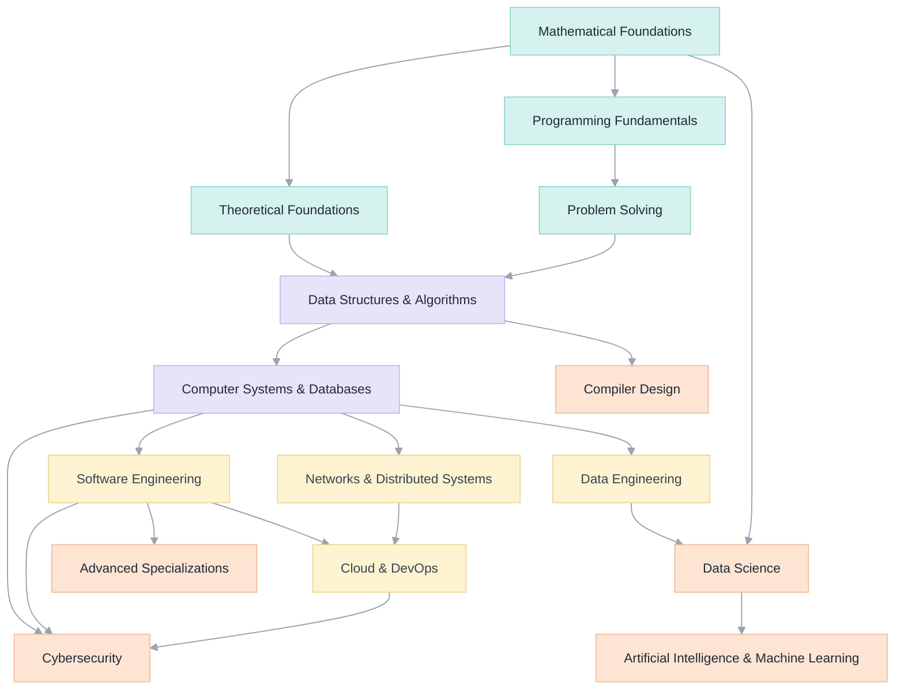

# 🧠 Computer Science

**A Comprehensive Computer Science & Engineering Knowledge Base and Learning Roadmap.**

> An open-source, structured, and continuously evolving knowledge base for learning Computer Science & Engineering—from mathematical foundations and programming fundamentals to algorithms, computer systems, software engineering, data, artificial intelligence, cybersecurity, and advanced specializations.

---

## 📖 About This Repository

**Computer Science** is a comprehensive, structured, and continuously evolving Computer Science & Engineering knowledge base. It is designed to support systematic learning, deep understanding, practical implementation, and long-term mastery.

The repository organizes major areas of computer science into a hierarchical learning ecosystem. It combines theoretical concepts with practical implementations, learning roadmaps, study plans, programming examples, algorithms, problem-solving patterns, visual diagrams, technical notes, references, exercises, and hands-on projects.

The repository has two complementary layers:

1. **Computer Science Knowledge Map:** A domain-oriented map of the major areas of Computer Science, their topics, subtopics, prerequisites, and interdisciplinary connections.
2. **Book-Driven Reading Tracks:** Twelve structured reading tracks that organize books, chapter notes, exercises, implementations, and references.

The knowledge map describes **what to learn**. The roadmap describes **how topics connect and when to approach them**. The reading tracks help organize **what to read, study, practice, and document**.

This project is an open learning log and reference—not a repository of copied textbook chapters. Its goal is to document understanding through original explanations, mathematical derivations, from-scratch implementations, experiments, projects, and carefully selected references.

### Mission

Build a publicly accessible, technically reliable, practical, and continuously improving computer science knowledge base that connects foundational theory with modern engineering practice.

$$
\underbrace{\text{Learn} \to \text{Understand} \to \text{Derive}}_{\text{Theory}} \to \underbrace{\text{Implement} \to \text{Analyze} \to \text{Build}}_{\text{Practice}} \to \underbrace{\text{Document} \to \text{Revise}}_{\text{Reflection}} \xrightarrow{\ \text{repeat}\ } \text{Learn}
$$

## 🎯 Core Objectives

- **Build strong foundations:** Develop a solid understanding of mathematics, logic, computational thinking, and programming fundamentals.
- **Master programming:** Learn programming concepts, paradigms, language features, software design principles, and development practices.
- **Master data structures and algorithms:** Understand fundamental and advanced data structures, algorithm design techniques, complexity analysis, and problem-solving patterns.
- **Understand computer systems:** Explore computer architecture, operating systems, computer networks, Linux, databases, and systems programming.
- **Learn software engineering:** Study requirements, design, architecture, testing, debugging, version control, and maintainable software.
- **Explore modern technologies:** Develop knowledge of distributed systems, cloud computing, DevOps, data engineering, data science, artificial intelligence, and cybersecurity.
- **Study computer science theory:** Understand discrete mathematics, automata, formal languages, computability, complexity theory, and compiler design.
- **Develop practical skills:** Reinforce theory through coding exercises, implementations, experiments, and real-world projects.
- **Build career readiness:** Connect foundational knowledge and specialized skills with computer science career paths.

## 🧭 Repository Navigation

| Document or section                                 | Purpose                                                                 |
| --------------------------------------------------- | ----------------------------------------------------------------------- |
| [Learning roadmap](./ROADMAP.md)                    | Recommended learning order, prerequisites, dependencies, and milestones |
| [Study plans](./STUDY-PLANS.md)                     | Semester-based, self-study, and focused study plans                     |
| [Career paths](./CAREER-PATHS.md)                   | Role descriptions, skill maps, and specialization guidance              |
| [Contributing](./CONTRIBUTING.md)                   | Documentation, code, and contribution standards                         |
| [Templates](./templates/)                           | Study-plan, project, weekly-review, and learning-log templates          |
| [Learning domains](#️-explore-the-learning-domains)  | Browse the subject directories                                          |
| [Reading tracks](#-books-and-reading-tracks)        | Browse the twelve book-driven tracks                                    |
| [Learning workflow](#-learning-philosophy)          | Understand the study and documentation cycle                            |
| [Repository structure](./STRUCTURE.md)              | Full folder tree of the repository                                      |

## 🗂️ Explore the Learning Domains

The repository is organized into domain-oriented directories. Each domain may contain topic folders, topic-level documentation, examples, exercises, implementations, diagrams, projects, and references.

|   # | Learning domain                                                                    | Main coverage                                                                                             |
| --: | ---------------------------------------------------------------------------------- | --------------------------------------------------------------------------------------------------------- |
|  00 | [Foundations and Math](./00-Foundations-and-Math/)                                 | Discrete mathematics, logic, proofs, linear algebra, probability, statistics, calculus, and number theory |
|  01 | [Programming Fundamentals](./Programming-Fundamentals/)                            | Core programming concepts, languages, paradigms, memory, debugging, and beginner projects                 |
|  02 | [Problem-Solving Method](./Problem-Solving-Method/)                                | Problem decomposition, constraints, examples, brute force, optimization, testing, and practice            |
|  03 | [DSA and DAA](./DSA-and-DAA/)                                                      | Data structures, algorithms, complexity, algorithmic techniques, and problem-solving patterns             |
|  04 | [Computer Systems](./Computer-Systems/)                                            | Architecture, operating systems, networks, and Linux                                                      |
|     | ↳ [Computer Architecture](./Computer-Systems/computer-architecture/)               | Digital logic, number systems, CPU, instruction sets, memory hierarchy, and I/O                           |
|     | ↳ [Operating Systems](./Computer-Systems/operating-systems/)                       | Processes, threads, scheduling, synchronization, memory management, and file systems                      |
|     | ↳ [Computer Networks](./Computer-Systems/computer-networks/)                       | Network models, addressing, protocols, routing, infrastructure, and network labs                          |
|     | ↳ [Linux and Shell](./Computer-Systems/linux-and-shell/)                           | Linux commands, permissions, processes, shell scripting, packages, and system tools                       |
|  05 | [Databases](./Databases/)                                                          | Relational models, SQL, normalization, transactions, indexing, and NoSQL                                  |
|  06 | [Software Development](./Software-Development/)                                    | Software engineering, web, mobile, and desktop applications                                               |
|     | ↳ [Software Engineering](./Software-Development/software-engineering/)             | Requirements, design, architecture, testing, quality, version control, and professional practice          |
|     | ↳ [Web Development](./Software-Development/web-development/)                       | Frontend, backend, HTTP, APIs, databases, authentication, and web application security                    |
|     | ↳ [Mobile Development](./Software-Development/mobile-development/)                 | Android, iOS, and cross-platform application development                                                  |
|     | ↳ [Desktop and Cross-Platform](./Software-Development/desktop-and-cross-platform/) | Electron and Tauri, Qt and native toolkits, and Flutter desktop                                           |
|  07 | [Scalable Systems](./Scalable-Systems/)                                            | System design and distributed systems                                                                     |
|     | ↳ [System Design](./Scalable-Systems/system-design/)                               | Scalability, availability, caching, load balancing, replication, and architecture                         |
|     | ↳ [Distributed Systems](./Scalable-Systems/distributed-systems/)                   | Consensus, coordination, failure modes, and distributed computing                                         |
|  08 | [Cloud and DevOps](./Cloud-and-DevOps/)                                            | Cloud platforms, containers, Kubernetes, CI/CD, infrastructure as code, and operations                    |
|  09 | [Data Engineering](./Data-Engineering/)                                            | Data modeling, storage, ingestion, ETL/ELT, orchestration, pipelines, and distributed processing          |
|  10 | [Data Science](./Data-Science/)                                                    | Data acquisition, cleaning, EDA, statistics, visualization, modeling, and experimentation                 |
|  11 | [Artificial Intelligence](./Artificial-Intelligence/)                              | AI foundations, search, reasoning, machine learning, deep learning, NLP, vision, and agents               |
|  12 | [Cybersecurity](./Cybersecurity/)                                                  | Security principles, cryptography, network and web security, secure coding, and vulnerability management  |
|  13 | [Theory of Computation](./Theory-of-Computation/)                                  | Automata, grammars, Turing machines, decidability, computability, and complexity                          |
|  14 | [Compiler Design](./Compiler-Design/)                                              | Lexing, parsing, semantic analysis, intermediate representations, optimization, and code generation       |
|  15 | [Specializations](./Specializations/)                                              | Embedded systems, IoT, graphics, and game development                                                     |
|  16 | [Projects](./Projects/)                                                            | Beginner, intermediate, and advanced projects                                                             |
|  17 | [Career and Resources](./Career-and-Resources/)                                    | Career paths, books, courses, communities, interviews, and portfolios                                     |

> **Directory note:** The numbered directory names (`00`–`17`) are the current organizational convention and match the folder plan. Rows marked ↳ are sub-folders of the module above them. Add or rename directories only when the repository structure is deliberately revised.

## 📚 Books and Reading Tracks

Twelve book-driven reading tracks complement the domain-oriented knowledge map. Each track can contain book lists, bibliographic information, chapter notes, worked examples, exercises, implementations, diagrams, revision notes, and further references.

|   # | Reading track                                | Main coverage                                                                                             | Directory                                                                                                          |
| --: | -------------------------------------------- | --------------------------------------------------------------------------------------------------------- | ------------------------------------------------------------------------------------------------------------------ |
|  01 | Mathematics for Computer Science             | Discrete mathematics, logic, proofs, linear algebra, calculus, probability, statistics, and number theory | [`01-Mathematics-for-CS/`](./resources/01-Mathematics-for-CS/)                                                     |
|  02 | Programming and Problem Solving              | Programming fundamentals, languages, paradigms, debugging, and problem-solving                            | [`02-Programming-and-Problem-Solving/`](./resources/02-Programming-and-Problem-Solving/)                           |
|  03 | Data Structures and Algorithms               | Data structures, algorithm analysis, design techniques, and complexity                                    | [`03-Data-Structures-and-Algorithms/`](./resources/03-Data-Structures-and-Algorithms/)                             |
|  04 | Theory of Computation                        | Automata, formal languages, grammars, computability, and complexity                                       | [`04-Theory-of-Computation/`](./resources/04-Theory-of-Computation/)                                               |
|  05 | Computer Architecture and Systems            | Digital logic, architecture, assembly, operating systems, and Linux                                       | [`05-Computer-Architecture-and-Systems/`](./resources/05-Computer-Architecture-and-Systems/)                       |
|  06 | Networks and Distributed Systems             | Networking, protocols, distributed computing, scalability, and reliability                                | [`06-Networks-and-Distributed-Systems/`](./resources/06-Networks-and-Distributed-Systems/)                         |
|  07 | Databases and Data Engineering               | Database theory, SQL, NoSQL, transactions, modeling, and pipelines                                        | [`07-Databases-and-Data-Engineering/`](./resources/07-Databases-and-Data-Engineering/)                             |
|  08 | Software Engineering and Development         | Software design, architecture, patterns, clean code, testing, and applications                            | [`08-Software-Engineering-and-Development/`](./resources/08-Software-Engineering-and-Development/)                 |
|  09 | Cloud and DevOps                             | Cloud architecture, containers, Kubernetes, CI/CD, infrastructure as code, and SRE                        | [`09-Cloud-and-DevOps/`](./resources/09-Cloud-and-DevOps/)                                                         |
|  10 | Cybersecurity and Cryptography               | Security principles, cryptography, network security, web security, and threat modeling                    | [`10-Cybersecurity-and-Cryptography/`](./resources/10-Cybersecurity-and-Cryptography/)                             |
|  11 | Data Science and Analytics                   | EDA, statistics, visualization, modeling, and experimentation                                             | [`11-Data-Science-and-Analytics/`](./resources/11-Data-Science-and-Analytics/)                                     |
|  12 | Artificial Intelligence and Machine Learning | AI, ML, deep learning, NLP, computer vision, reinforcement learning, and agents                           | [`12-Artificial-Intelligence-and-Machine-Learning/`](./resources/12-Artificial-Intelligence-and-Machine-Learning/) |

Advanced reading collections may be added for compiler design, graphics, game development, embedded systems, blockchain, quantum computing, and high-performance computing. These are optional specializations, not mandatory prerequisites for every learner.

See [`resources/README.md`](./resources/README.md) for reading-track navigation and book-note conventions.

## 🧠 Learning Philosophy

The repository follows a structured, concept-first, practice-oriented learning approach:

$$
\textbf{Understand} \to \textbf{Connect} \to \textbf{Implement} \to \textbf{Practice} \to \textbf{Analyze} \to \textbf{Review} \to \textbf{Apply}
$$

Each subject should be approached progressively: learn its prerequisites, understand its fundamental concepts, work through examples, practice, implement where appropriate, and then explore advanced applications.

The goal is not simply to collect information or finish a list of topics. It is to develop connected understanding, strengthen problem-solving ability, and learn how theoretical principles translate into working software and real-world systems.

### Learning and documentation cycle

1. **Research:** Consult textbooks, academic papers, official documentation, and reputable educational resources.
2. **Understand:** Break complex ideas into smaller concepts; work through definitions, derivations, proofs, and examples.
3. **Implement:** Write code from scratch where useful, test edge cases, and analyze complexity.
4. **Practice:** Solve exercises and progressively challenging problems.
5. **Document:** Explain concepts in original words and include diagrams, examples, and references.
6. **Review:** Revisit topics, identify gaps, revise notes, and improve implementations.
7. **Apply:** Build projects and combine knowledge from multiple domains.

### Intended audience

- Computer Science and Engineering students.
- Self-taught programmers and independent learners.
- Beginners building strong computer science foundations.
- Software developers strengthening their fundamentals.
- Competitive programmers and algorithm enthusiasts.
- Students preparing for technical interviews and examinations.
- Learners exploring AI, data science, cybersecurity, and other specializations.
- Anyone who wants to study computer science systematically.

## 🔗 Knowledge Connections

Computer science is interconnected. The diagram below shows how the major areas build on one another, and the table after it lists specific relationships between topics.

### 🗺️ Conceptual Learning Map

_This is a conceptual relationship diagram, not a strict prerequisite graph._

### Key relationships

| Foundation                     | Connects to                                                 | Practical applications                             |
| ------------------------------ | ----------------------------------------------------------- | -------------------------------------------------- |
| Discrete mathematics           | Algorithms, databases, cryptography, and computation theory | Proofs, correctness, logic, and formal models      |
| Linear algebra                 | Machine learning, graphics, and scientific computing        | Neural networks, transformations, and optimization |
| Probability and statistics     | AI, data science, and randomized algorithms                 | Inference, prediction, and experimentation         |
| Data structures and algorithms | Software, databases, and system design                      | Efficient programs and scalable applications       |
| Computer architecture          | Operating systems, compilers, and performance engineering   | Memory, execution, and optimization                |
| Operating systems and networks | Distributed systems, cloud, and security                    | Concurrency, communication, and infrastructure     |
| Databases                      | Backend development and data engineering                    | Persistence, transactions, and data management     |
| Software engineering           | Application development, architecture, and DevOps           | Maintainable, testable, reliable software          |

## 📈 Learning Progress

Use a consistent status vocabulary when tracking topics:

| Status         | Meaning                                                                          |
| -------------- | -------------------------------------------------------------------------------- |
| ⬜ Not started | The topic has not yet been studied                                               |
| 🟡 In progress | The topic is currently being studied or documented                               |
| 🟢 Completed   | The core concepts have been understood and documented                            |
| 🔵 Implemented | A relevant practical implementation has been completed                           |
| 🟣 Mastered    | Understanding has been validated through deeper practice, projects, and revision |

A topic should not be marked complete merely because its material has been read. A strong completion standard includes explaining it in your own words, solving relevant problems, implementing important concepts where appropriate, understanding its limitations, identifying connections, and revising it later.

## 🧰 Repository Conventions

- **Folder names identify content; documentation explains learning order.**
- Use descriptive, lowercase kebab-case names for topic directories unless an established numbered convention applies.
- Use Python as the primary language for DSA examples and algorithm demonstrations where appropriate.
- Keep code examples readable, tested, and accompanied by explanations.
- Prefer original explanations over copied source material.
- Cite books, papers, documentation, and other sources for factual claims.
- Use diagrams when they clarify relationships, execution, architecture, or workflows.
- Keep topic-level documentation close to the code and materials it explains.
- Update navigation links whenever directories are added, removed, or renamed.

## 🤝 Contributions and Feedback

Constructive contributions are welcome. You can help by correcting technical inaccuracies, improving explanations, suggesting credible learning resources, adding examples and diagrams, improving implementations and tests, or identifying missing topics and prerequisite relationships.

Read [`CONTRIBUTING.md`](./CONTRIBUTING.md) before submitting substantial changes.

## 📜 License

This repository is licensed under the MIT License. See [`LICENSE`](./LICENSE) for the license text.

## 🌱 Long-Term Vision

Create a comprehensive, well-organized, practical, and reliable computer science reference that connects fundamental theory, modern technologies, implementation techniques, research directions, and professional development in one continuously evolving knowledge base.

$$
\textbf{Learn deeply.} \quad \textbf{Think algorithmically.} \quad \textbf{Build systematically.} \quad \textbf{Improve continuously.}
$$
