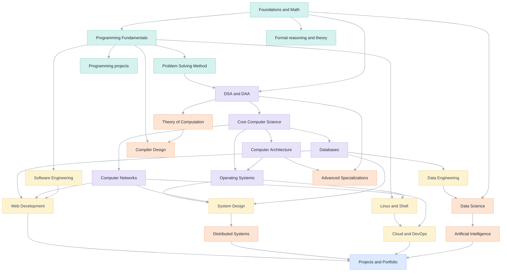

# 🗺️ Computer Science Learning Roadmap

> A dependency-aware learning path through Computer Science & Engineering. Use it as a flexible guide—not as a rigid timetable or a requirement to master every specialization.

## 1. How to Use This Roadmap

This roadmap describes a recommended progression, important prerequisites, and points where learning paths branch. It complements the repository's domain folders:

- `00-Foundations-and-Math/`
- `01-Programming-Fundamentals/`
- `02-Problem-Solving-Method/`
- `03-DSA-and-DAA/`
- `04-Computer-Architecture/` through `24-Career-and-Resources/`

Study foundational topics before relying on them in advanced subjects. However, do not wait to finish all mathematics before programming, or all core subjects before building projects. Alternate theory, implementation, and practice.

### Learning loop

**Learn the concept → work through examples → implement → solve problems → explain → review → apply.**

## 2. Roadmap at a Glance

The diagram is a high-level map. It intentionally shows conceptual relationships rather than every prerequisite. The directory numbering is organizational and should not be interpreted as a strict chronological sequence.

## 3. Stage-by-Stage Learning Path

### Stage 0 — Mathematical and Logical Foundations

**Repository:** `00-Foundations-and-Math/`

Study:

- Propositional and predicate logic.
- Sets, relations, and functions.
- Counting, permutations, and combinations.
- Proof techniques: direct proof, contradiction, contrapositive, and induction.
- Graph theory fundamentals.
- Vectors, matrices, and linear algebra.
- Probability, distributions, expectation, and variance.
- Descriptive and inferential statistics.
- Limits, derivatives, integrals, and optimization.
- Elementary number theory.

**Milestone:** Explain basic mathematical statements, use proof techniques, manipulate sets and functions, and solve introductory counting and probability problems.

**Why it matters:** Discrete mathematics supports algorithms and theory; linear algebra and statistics support data science and AI; number theory supports cryptography.

### Stage 1 — Programming Fundamentals

**Repository:** `01-Programming-Fundamentals/`

Study:

- Variables, types, expressions, and operators.
- Input/output and control flow.
- Functions, scope, and modularity.
- Arrays, strings, and basic collections.
- Recursion and call-stack behavior.
- Data representation and memory basics.
- Pointers and references where relevant.
- Error handling, debugging, and testing.
- Procedural, object-oriented, and functional programming concepts.
- Git fundamentals and command-line basics.

Use Python as the primary language for early problem-solving. Learn C or C++ when you need to understand lower-level memory and systems concepts. Add other languages when a project or specialization requires them.

**Milestone:** Build small command-line programs, decompose a problem into functions, use collections, debug errors, and write basic tests.

### Stage 2 — Problem-Solving Method

**Repository:** `02-Problem-Solving-Method/`

Use a repeatable process:

1. Restate the problem.
2. Identify inputs, outputs, constraints, and assumptions.
3. Work through examples and edge cases.
4. Develop a straightforward solution.
5. Analyze its time and space complexity.
6. Identify bottlenecks and relevant patterns.
7. Choose suitable data structures and algorithms.
8. Implement and test.
9. Explain correctness and trade-offs.
10. Review the solution and record lessons.

Practice patterns such as frequency counting, two pointers, sliding window, prefix sums, binary search, stacks, queues, intervals, tree traversal, graph traversal, backtracking, and dynamic programming as their prerequisites are learned.

**Milestone:** Independently turn a problem statement into a tested solution and explain why it works.

### Stage 3 — Data Structures and Algorithms

**Repository:** `03-DSA-and-DAA/`

Study in a progressive order:

- Complexity analysis: Big-O, Big-Theta, and Big-Omega.
- Arrays, strings, linked lists, stacks, and queues.
- Hash tables, sets, and maps.
- Recursion and backtracking.
- Trees, binary trees, and binary search trees.
- Heaps and priority queues.
- Tries and range-query structures.
- Graph representations and traversal.
- Sorting and searching.
- Divide and conquer, greedy algorithms, and dynamic programming.
- Shortest paths, minimum spanning trees, and other graph algorithms.
- Disjoint-set union, string algorithms, and mathematical algorithms.
- Amortized analysis, correctness proofs, and advanced topics.

**Milestone:** Select appropriate data structures, analyze complexity, implement core algorithms, and solve unfamiliar problems using a clear reasoning process.

See the DSA domain README for the detailed topic hierarchy and implementation standards.

### Stage 4 — Core Computer Systems

**Repositories:** `04-Computer-Architecture/`, `05-Operating-Systems/`, `07-Computer-Networks/`, and `09-Linux-and-Shell/`

Learn how programs execute and how computers provide resources:

- Binary and hexadecimal representation.
- Boolean algebra and digital logic.
- CPU organization, instruction sets, registers, and memory hierarchy.
- Assembly-language fundamentals.
- Processes, threads, scheduling, and context switching.
- Concurrency, synchronization, and deadlocks.
- Virtual memory, paging, and file systems.
- OS interfaces and system calls.
- Linux commands, permissions, processes, and shell scripting.
- Network models, IP addressing, DNS, TCP, UDP, HTTP, and TLS.
- Routing, switching, and basic network troubleshooting.

**Milestone:** Explain how a program is represented and executed, how an operating system manages resources, and how applications communicate over networks.

### Stage 5 — Databases and Software Engineering

**Repositories:** `06-Databases/` and `08-Software-Engineering/`

Databases:

- Relational models, keys, constraints, and ER modeling.
- SQL querying and data manipulation.
- Functional dependencies and normalization.
- Indexes and query execution.
- Transactions, ACID, concurrency control, and recovery.
- NoSQL models and use cases.

Software engineering:

- Requirements and specification.
- Modularity, abstraction, and interface design.
- Object-oriented design and SOLID principles.
- Common design patterns and architectural styles.
- Git branching, merging, and code review.
- Unit, integration, and end-to-end testing.
- Debugging, documentation, and maintainability.

**Milestone:** Design a normalized database and build a tested application with clear modules, version control, and documentation.

### Stage 6 — Application Development

**Repositories:** `10-Web-Development/` and `11-Mobile-Development/`

Choose an application path based on your goals.

Web development:

- HTML, CSS, and JavaScript fundamentals.
- Browser, DOM, and HTTP concepts.
- Frontend frameworks when appropriate.
- Backend runtimes and application frameworks.
- REST API design and consumption.
- Authentication, authorization, and session management.
- Database integration, caching, and deployment.
- Web security fundamentals.

Mobile development:

- Android or iOS platform fundamentals.
- Application lifecycle and UI architecture.
- Local persistence and networking.
- Device capabilities and permissions.
- Cross-platform options such as Flutter or React Native.

**Milestone:** Build and deploy a complete application with a usable interface, API or data layer, tests, and basic security controls.

### Stage 7 — Advanced Engineering

**Repositories:** `17-Cloud-and-DevOps/`, `18-System-Design/`, and `19-Distributed-Systems/`

Cloud and DevOps:

- Cloud service and deployment models.
- Virtual machines, containers, and orchestration.
- Docker and Kubernetes fundamentals.
- CI/CD pipelines.
- Infrastructure as code.
- Monitoring, logging, tracing, and alerting.
- Reliability, incident response, and cost awareness.

System design:

- Functional and non-functional requirements.
- Latency, throughput, availability, and reliability.
- Load balancing, caching, and CDNs.
- Replication, partitioning, and sharding.
- Queues, event-driven systems, and rate limiting.
- Capacity estimation and trade-off analysis.

Distributed systems:

- Partial failure and network partitions.
- Time, ordering, and coordination.
- Replication and consistency models.
- Consensus concepts, including Raft and Paxos.
- Quorums, leader election, and fault tolerance.

**Milestone:** Design and explain a service architecture, identify bottlenecks and failure modes, and deploy a small service with monitoring.

### Stage 8 — Data and Intelligent Systems

**Repositories:** `14-Data-Engineering/`, `13-Data-Science/`, and `12-Artificial-Intelligence/`

Data engineering:

- Data formats, storage, and modeling.
- Batch and streaming ingestion.
- ETL/ELT and orchestration.
- Warehouses, lakes, and lakehouses.
- Distributed processing.
- Data quality, lineage, and governance.

Data science:

- Data acquisition and sampling.
- Cleaning and exploratory data analysis.
- Probability, statistics, and inference.
- Visualization and communication.
- Hypothesis testing and experimentation.
- Predictive modeling and evaluation.

Artificial intelligence:

- Intelligent agents, search, and planning.
- Knowledge representation and reasoning.
- Supervised and unsupervised learning.
- Model evaluation and feature engineering.
- Neural networks and deep learning.
- NLP, computer vision, and reinforcement learning.
- Generative AI, language models, retrieval, and agents.
- Responsible AI and evaluation.

**Milestone:** Complete an end-to-end data or AI project with documented assumptions, reproducible code, evaluation, and limitations.

### Stage 9 — Theory, Compilers, and Specialization

**Repositories:** `20-Theory-of-Computation/`, `21-Compiler-Design/`, and `22-Specializations-Not-Elsewhere/`

Theory of computation:

- Finite automata and regular languages.
- Context-free grammars and pushdown automata.
- Turing machines.
- Decidability and computability.
- Complexity classes and reductions.

Compiler design:

- Lexical analysis and parsing.
- Abstract syntax trees.
- Semantic analysis and type checking.
- Intermediate representations.
- Optimization and code generation.
- Runtime environments and virtual machines.

Optional specializations:

- Embedded systems and IoT.
- Computer graphics and rendering.
- Game development.
- Blockchain and distributed ledgers.
- Quantum computing.
- High-performance and parallel computing.

**Milestone:** Complete a substantial theory or specialization project, such as a small interpreter, compiler component, graphics demo, embedded application, or parallel program.

### Stage 10 — Integration, Projects, and Professional Practice

**Repositories:** `23-Projects/` and `24-Career-and-Resources/`

Build projects that combine multiple areas. Progress from small exercises to integrated applications and advanced systems.

Examples:

- CLI utilities and automation tools.
- Data-structure and algorithm visualizers.
- A database-backed web application.
- A REST API with authentication and tests.
- A data ingestion and transformation pipeline.
- A search or recommendation prototype.
- A distributed chat or task-processing system.
- A compiler or interpreter.
- A machine-learning application with an evaluation report.

Maintain a portfolio with clear READMEs, architecture diagrams, setup instructions, tests, decisions, and known limitations.

**Milestone:** Demonstrate that you can understand a problem, design a solution, implement it, test it, explain trade-offs, and maintain the result.

## 4. Prerequisite Map

| Topic                          | Helpful prerequisites                                                  |
| ------------------------------ | ---------------------------------------------------------------------- |
| Programming fundamentals       | Basic computer use and logical reasoning                               |
| Discrete mathematics           | Arithmetic and algebra                                                 |
| Data structures and algorithms | Programming fundamentals; discrete mathematics is strongly helpful     |
| Computer architecture          | Binary representation and basic programming                            |
| Operating systems              | Programming, architecture, and basic data structures                   |
| Computer networks              | Basic programming and computer systems                                 |
| Databases                      | Programming and basic data modeling                                    |
| Software engineering           | Programming and problem-solving                                        |
| Web development                | Programming, HTTP basics, and databases for backend work               |
| System design                  | Programming, databases, networking, and software engineering           |
| Distributed systems            | Networks, operating systems, concurrency, and system design            |
| Data science                   | Python, statistics, probability, and linear algebra                    |
| Machine learning               | Programming, linear algebra, probability, statistics, and optimization |
| Deep learning                  | Machine learning and linear algebra                                    |
| Theory of computation          | Discrete mathematics, logic, and proof techniques                      |
| Compiler design                | Programming, data structures, grammars, and automata                   |
| Cybersecurity                  | Systems, networking, programming, and security fundamentals            |
| Cloud and DevOps               | Linux, networking, programming, and application development            |

Prerequisites are guidance, not absolute gates. A learner may study introductory material earlier and return to deeper prerequisites when needed.

## 5. Suggested Milestones and Evidence

| Milestone                | Evidence of progress                                             |
| ------------------------ | ---------------------------------------------------------------- |
| Programming fluency      | Several small programs, functions, tests, and debugging practice |
| Mathematical foundations | Worked solutions, proofs, and clear explanations                 |
| DSA competence           | Implementations, complexity analyses, and solved problems        |
| Systems understanding    | Labs, command-line work, and system explanations                 |
| Application development  | A tested application with documentation                          |
| Data competence          | A reproducible analysis or pipeline                              |
| AI competence            | A model project with evaluation and limitations                  |
| Advanced engineering     | A designed, deployed, or simulated system                        |
| Professional readiness   | A coherent portfolio and ability to explain technical decisions  |

## 6. Flexible Learning Rules

- Do not treat the stages as a strict semester schedule.
- Study programming and mathematics in parallel.
- Revisit earlier concepts when advanced topics expose gaps.
- Prefer active problem solving over passive reading.
- Build small projects throughout the roadmap, not only at the end.
- Learn tools when they help you understand or build something.
- Choose specializations based on genuine interest and project goals.
- Record sources and distinguish established facts from personal experiments or opinions.

## 7. Definition of Done for a Topic

A topic is ready to be marked complete when you can:

1. Define its central concepts accurately.
2. Explain the main ideas in your own words.
3. Work through representative examples.
4. Solve relevant exercises without copying a solution.
5. Implement important ideas where implementation is appropriate.
6. Analyze complexity, trade-offs, or limitations where relevant.
7. Connect the topic to prerequisites and related subjects.
8. Return to the topic later and still explain it.

**The objective is durable understanding and practical capability—not simply checking off folders.**
